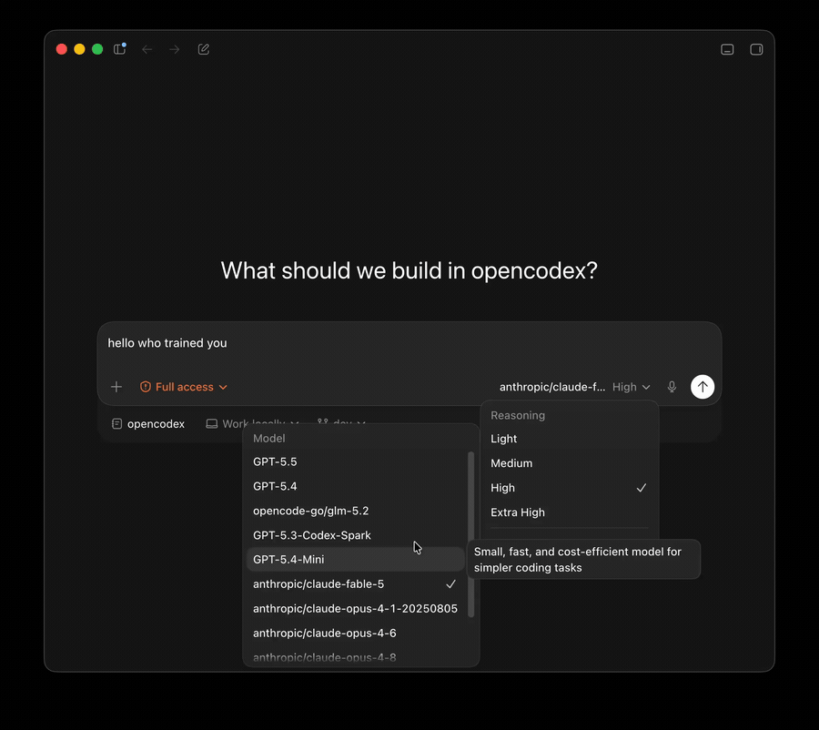

<p align="center">
  
</p>

<h1 align="center">EasyProxy</h1>

<p align="center">
  Une passerelle locale pour vos outils de programmation IA et vos modèles.
  <br>
  Utilisez les modèles de votre choix avec Codex, Claude Code, Claude Desktop et Grok Build, ou connectez OpenCode, Pi, Qoder, WorkBuddy, Kilo, Cline, T3 Code et d’autres outils grâce aux configurations gérées.
  <br>
  <a href="#quick-start"><b>Installer ↓</b></a> · <a href="https://easyproxy.me/fr/reference/client-support/"><b>Outils pris en charge →</b></a>
</p>

<p align="center">
  <a href="https://github.com/AquilaXk/easyproxy/releases/latest/download/EasyProxy-windows-x64.msi"></a>
  &nbsp;
  <a href="https://github.com/AquilaXk/easyproxy/releases/latest/download/EasyProxy-macos-arm64.dmg"></a>
  &nbsp;
  <a href="https://github.com/AquilaXk/easyproxy/releases/latest/download/EasyProxy-linux-x86_64.AppImage"></a>
  <br>
  <sub>Le bouton macOS est destiné à Apple Silicon (arm64). <a href="https://github.com/AquilaXk/easyproxy/releases/latest/download/EasyProxy-macos-x64.dmg">macOS Intel (.dmg)</a> · <a href="https://github.com/AquilaXk/easyproxy/releases/latest/download/EasyProxy-linux-amd64.deb">Linux (.deb)</a> · <a href="https://github.com/AquilaXk/easyproxy/releases/latest">Tous les fichiers et sommes de contrôle</a></sub>
</p>

<p align="center">
  <a href="https://github.com/AquilaXk/easyproxy/actions/workflows/ci.yml"></a>
  <a href="https://github.com/AquilaXk/easyproxy/releases/latest"></a>
  <a href="https://github.com/AquilaXk/easyproxy/blob/main/LICENSE"></a>
  = 18" src="https://img.shields.io/badge/node-%3E%3D18-339933?style=flat-square&logo=node.js&logoColor=white">
  <a href="https://github.com/sponsors/AquilaXk"></a>
</p>

<p align="center">
  <a href="../README.md">English</a> · <b>Français</b> · <a href="README.ko.md">한국어</a> · <a href="README.zh-CN.md">简体中文</a> · <a href="README.zh-TW.md">繁體中文</a> · <a href="README.ru.md">Русский</a> · <a href="README.ja.md">日本語</a> · <a href="README.tr.md">Türkçe</a> · 📖 <a href="https://easyproxy.me/fr/"><b>Documentation complète →</b></a>
</p>

```bash
npm install -g --allow-scripts=bun easyproxy
epx start
```

<table>
<tr>
<td width="50%" valign="middle">

### Claude Code, exécutant n'importe quel modèle

Le sélecteur reste celui de Claude Code. Le modèle derrière est celui que vous choisissez.

</td>
<td width="50%">
  
</td>
</tr>
<tr>
<td width="50%" valign="middle">

### Codex, exécutant n'importe quel modèle

Choisissez un fournisseur et conservez votre flux de travail habituel.

</td>
<td width="50%">
  
</td>
</tr>
<tr>
<td width="50%" valign="middle">

### Claude Desktop, exécutant n'importe quel modèle

Opus répond, puis confie la tâche à un sous-agent GPT-5.6 Sol.

</td>
<td width="50%">
  
</td>
</tr>
<tr>
<td width="50%" valign="middle">

### Grok Build, exécutant n'importe quel modèle

Sol pilote la session et appelle un sous-agent Kimi K3.

</td>
<td width="50%">
  
</td>
</tr>
</table>

easyproxy est une passerelle locale légère entre vos outils de programmation et vos fournisseurs de modèles. Elle accepte les API Responses, Chat Completions et Anthropic Messages et traduit chaque requête pour votre fournisseur, en prenant en charge le streaming, les appels d’outils, le raisonnement et les images lorsque le client, le modèle et le fournisseur le permettent. Utilisez Claude, Gemini, Grok, GLM, DeepSeek, Kimi, Qwen, Ollama et d’autres fournisseurs avec Codex, Claude Code, Claude Desktop, Grok Build et les outils de la [page des clients pris en charge](https://easyproxy.me/fr/reference/client-support/).

## Points forts

- **Utilisez n'importe quel LLM avec Codex, Claude Code, Claude Desktop et Grok Build.** Plus de 40 fournisseurs prêts à l'emploi, chacun conservant sa propre interface native.
- **Combos.** Un identifiant de modèle virtuel avec basculement ou round-robin pondéré entre fournisseurs. Consultez le [guide des combos](https://easyproxy.me/fr/guides/combos/).
- **Des sous-agents sur n'importe quel modèle.** Affichez les modèles routés dans le sélecteur de sous-agents de Codex, avec contrôle des surfaces v1/v2 et chaînes de repli. Consultez le [guide des sous-agents](https://easyproxy.me/fr/guides/sub-agent-surface/).
- **Connectez-vous une fois ou utilisez une clé API.** OAuth pour xAI, Anthropic et Kimi ; transmission de `codex login` ; clé API collée ou références `${ENV_VAR}`.
- **Modules complémentaires de recherche web et de vision.** Les modèles non-OpenAI bénéficient d'une véritable recherche web et de la compréhension d'images grâce à un module complémentaire utilisant votre connexion ChatGPT.
- **Tableau de bord et journaux en direct.** Affichez les fournisseurs, l'état OAuth, la sélection des modèles et un journal des requêtes en direct avec le nombre de jetons de cache.
- **Arrêt propre.** `epx stop` restaure la configuration d'origine de Codex.
- **Gestion bornée de la mémoire.** Chaque cache, tampon circulaire et stockage de traduction de protocole à longue durée de vie possède une limite finie, un budget en octets ou une réconciliation active. Aucun `Map` ou `Set` non borné ne subsiste après le rechargement de la configuration.

<details>
<summary>Détails de la gestion de la mémoire</summary>

EasyProxy suit l'état conservé par le processus dans les catégories ci-dessous. Chacune possède une limite documentée :

- **15 stockages conservés** (journal des requêtes, tampons circulaires de débogage, cache d'images, cache de
  modèles, descriptions visuelles, blobs de curseurs, continuation des réponses, etc.) sont comptabilisés en octets et
  évincés selon le budget mémoire géré par l'application (256 Mio par défaut), sauf le stockage de
  rejeu des contrôles natifs, épinglé et jamais évincé.
- **4 tampons observés** (accumulateurs de traduction, segments finaux d'images/OAuth/Grok) sont
  surveillés pour détecter la pression des octets en cours de traitement, sans éviction.
- **32 enregistrements de stockages d'état** gèrent les balayages d'expiration (intervalle de 60 s) et la
  réconciliation des générations de configuration afin de supprimer les clés obsolètes des fournisseurs et des comptes.
- **Les mémos de chemins et d'empreintes** (métadonnées de l'espace de travail, identités renforcées, sels
  d'installation, capacités indiquées par le mode) utilisent des limites LRU selon l'ordre d'insertion (8 à 128 entrées).
- **Les marqueurs de suppression des générations du cache de modèles** sont supprimés après réconciliation ; une incrémentation globale
  de la génération empêche les découvertes obsolètes en cours de repeupler les fournisseurs
  supprimés.
- **La déduplication des identifiants d'événements du Lab** s'exécute sous un verrou de registre sur disque, sans
  index en mémoire vive au niveau du processus.

Exécutez `GET /api/system/memory` (avec le jeton d'administration) pour consulter en direct les octets
conservés, les compteurs d'éviction et les échantillons du watchdog.

</details>

<a id="quick-start"></a>

## Démarrage rapide

### Installation personnelle (CLI)

```bash
npm install -g --allow-scripts=bun easyproxy   # Node 18+ ; le runtime Bun est inclus automatiquement
epx start                         # proxy + tableau de bord sur localhost:10100
```

Utilisez `epx service` pour l'exécuter en arrière-plan.

Ouvrez **http://localhost:10100** et configurez tout dans le tableau de bord web : ajoutez des
fournisseurs (plus de 40 intégrés, ou n'importe quel point de terminaison compatible OpenAI),
choisissez les modèles et gérez les comptes. `epx gui` rouvre le tableau de bord à tout moment.

### Connectez votre outil

Connectez l’outil que vous utilisez déjà :

| Outil | Connexion |
|---|---|
| Codex | Activez le commutateur Codex sur la page **Route** du tableau de bord, puis exécutez `codex` comme d’habitude. Sur une écoute locale, cela dirige le fournisseur intégré de Codex vers le proxy. Depuis le terminal, exécutez `epx init` avant d’ajouter des fournisseurs dans le tableau de bord et acceptez son invite Codex. |
| Claude Code | Avec le CLI `claude` installé, exécutez `epx claude`. Il démarre le proxy si nécessaire et lance Claude Code à travers celui-ci. |
| Claude Desktop | Exécutez `epx claude desktop`. Lors d’une nouvelle installation, cette commande configure le profil de passerelle pour toute l’application ; une configuration first-party existante est conservée et `epx claude desktop apply --gateway` permet de changer explicitement. Consultez le [guide Claude Code](https://easyproxy.me/fr/guides/claude-code/). Quittez complètement puis rouvrez Claude Desktop après un changement. |
| Grok Build | Sur une écoute locale avec l’intégration Grok activée, `epx start` enregistre les modèles lorsque `~/.grok` existe ; choisissez un modèle `epx-*` dans Grok Build. Pour une configuration distante, consultez le [guide Grok Build](https://easyproxy.me/fr/guides/grok-build/). Après avoir ajouté des fournisseurs, redémarrez le proxy (ou lancez `epx ensure` lorsque le démarrage automatique de Codex est activé) pour actualiser la liste. |
| Outils avec intégration gérée | Utilisez la page **Route** du tableau de bord ou `epx integration client enable --client <id>`. |
| Tout autre outil | Définissez l’URL de base compatible OpenAI `http://localhost:10100/v1` ou l’URL de base Anthropic `http://localhost:10100`. |

La [page des clients pris en charge](https://easyproxy.me/fr/reference/client-support/) indique la méthode de connexion et le protocole de chaque outil.

<details>
<summary><b>Application de bureau (bêta)</b></summary>

L'application de bureau reprend le même proxy et le même tableau de bord dans une fenêtre native, avec une icône dans la barre d'état et le binaire `epx` inclus.
Elle se rattache à un proxy déjà en cours d'exécution ou démarre celui qui est fourni, et le tableau de bord reste
sur le port du proxy (**http://localhost:10100** sauf si vous en avez configuré un autre). Choisissez le fichier
correspondant à votre plateforme sur la page de la [dernière version publiée](https://github.com/AquilaXk/easyproxy/releases/latest) :

| Plateforme | Fichier | Remarques |
|---|---|---|
| macOS 14+ (Apple Silicon) | `EasyProxy-<version>-macos-arm64.dmg` | Pas encore signée ni notarisée (la signature Apple Developer ID viendra plus tard). Si macOS bloque le premier lancement, ouvrez **Réglages Système → Confidentialité et sécurité** et cliquez sur **Ouvrir quand même** ; le clic droit → Ouvrir ne fonctionne plus sous macOS 15+. Alternative : `xattr -dr com.apple.quarantine /Applications/EasyProxy.app` |
| macOS 14+ (Intel) | `EasyProxy-<version>-macos-x64.dmg` | Build x64 distinct ; mêmes étapes au premier lancement tant qu’il n’est pas signé |
| Windows (x64) | `EasyProxy-<version>-windows-x64.msi` | Signature du code via SignPath Foundation en cours de déploiement ([politique de signature du code](https://easyproxy.me/fr/reference/code-signing/)) ; tant qu’une version n’est pas signée, SmartScreen demande une confirmation : choisissez **Informations complémentaires → Exécuter quand même** |
| Linux (x86_64) | `EasyProxy-<version>-linux-x86_64.AppImage` ou `-linux-amd64.deb` | La barre d'état nécessite un environnement de bureau compatible AppIndicator |

Chaque fichier est accompagné d'un `.sha256` sur la page de la version, et des noms de fichiers sans numéro de version (`EasyProxy-macos-arm64.dmg`, `EasyProxy-macos-x64.dmg`, `EasyProxy-windows-x64.msi`, `EasyProxy-linux-x86_64.AppImage`, `EasyProxy-linux-amd64.deb`) pointent vers les mêmes builds vérifiés sur `/releases/latest`. Sous macOS 14+, l'application embarque
également une extension WidgetKit qui affiche l'état du proxy, l'utilisation du jour et les quotas des
fournisseurs ; le modèle de données des instantanés qu'elle affiche se trouve dans [`app/`](../app)
(`MenuBarCore`). Pour compiler l'application vous-même, exécutez
`bun install && bun run build:gui` à la racine du dépôt, puis, dans `desktop/`,
`bun install && bun run prepare-sidecar && bun run prepare-widget && bun run build:local` sous macOS,
ou `bun install && bun run prepare-sidecar && bun run build:local` sous Windows et Linux (l'étape du widget
exige macOS). Le [guide de l'application de bureau](https://easyproxy.me/fr/guides/desktop-app/) et le
[guide de l'application macOS dans la barre des menus](https://easyproxy.me/fr/guides/macos-menu-bar/) détaillent le premier lancement, et
[`CLI_CONSENT.md`](../CLI_CONSENT.md#where-things-are-installed) répertorie tout ce qui est écrit sur le disque.

</details>

<details>
<summary><b>Plateformes prises en charge</b></summary>

| Système d'exploitation | État | Gestionnaire de services | Application de bureau (bêta) |
|---|---|---|---|
| macOS (arm64 / x64) | Entièrement pris en charge | launchd | `arm64` / `x64` `.dmg` |
| Linux (x64 / arm64) | Entièrement pris en charge | systemd (unité utilisateur) | x86_64 `.AppImage` / `.deb` |
| Windows (x64) | Entièrement pris en charge | Planificateur de tâches (masqué) / service natif en option (`--native`, WinSW) | x64 `.msi` |

L'installation de la CLI nécessite [Node](https://nodejs.org) 18+ ; l'application de bureau n'a besoin ni de Node ni de Bun. L'environnement d'exécution Bun est inclus lors de `npm install`, aucune installation séparée de Bun ni WSL sous Windows ne sont nécessaires. Si npm a bloqué les scripts d'installation de l'environnement inclus, consultez la [documentation d'installation](https://easyproxy.me/fr/getting-started/installation/).

</details>

<details>
<summary><b>Docker Compose</b></summary>

Le dépôt fournit une construction Compose épinglée par digest, exécutée hors root. La construction génère et
vérifie elle-même le manifeste de compatibilité canonique à partir de l'instantané Git sélectionné. Un clone local
nécessite Git et Docker Compose ; un contexte Git distant ne nécessite que Docker Compose. Aucun des deux chemins
ne requiert Bun sur l'hôte ni d'étape de préparation. Initialisez une seule fois le jeton du plan de données via
stdin et démarrez le hub :

```bash
git clone https://github.com/AquilaXk/easyproxy.git
cd easyproxy
docker compose build
openssl rand -hex 32 | docker compose run --rm -T hub bun run docker/bootstrap-token.ts
docker compose up -d
curl --fail --silent http://127.0.0.1:10100/healthz
curl --fail --silent http://127.0.0.1:10100/readyz
```

La liaison hôte par défaut est `127.0.0.1:10100`. Une exposition distante exige explicitement
`EASYPROXY_BIND_ADDRESS=<LAN-or-Tailscale-IP> docker compose up -d` ; `0.0.0.0` active
toutes les interfaces de l'hôte. Restreignez l'accès avec un pare-feu et une façade TLS/tailnet authentifiée.
Le JSON généré reste non suivi. Le contexte de construction n'admet que `.git/index` et `.git/HEAD`, l'inventaire
lu par `git ls-files` (environ 1 Mo au lieu du magasin d'objets complet), et ils ne sont visibles que par l'étape
de manifeste réservée à la construction via un montage en lecture seule ; aucun `COPY` n'inclut donc `.git`. Un manifeste
déjà généré sur l'hôte n'est accepté qu'après validation ; sinon, la construction le génère elle-même. La construction
rejette les manifestes obsolètes, les fichiers manquants ou non concordants, les fichiers sources en trop et les liens symboliques.
Elle vérifie chaque SHA-256 enregistré par rapport au contexte de construction et aux fichiers d'exécution copiés, y compris
`package.json`, `bun.lock` et le fichier spécifiquement inclus `scripts/model-metadata.source.json`.

Un contexte Git distant exige que BuildKit conserve les métadonnées Git. Cet extrait de configuration Compose
sélectionne l'instantané distant et transmet l'argument intégré requis :

```yaml
services:
  hub:
    pull_policy: build
    build:
      context: https://github.com/AquilaXk/easyproxy.git#main
      dockerfile: Dockerfile
      target: runtime
      args:
        BUILDKIT_CONTEXT_KEEP_GIT_DIR: "1"
```

Le jeton et l'état mutable restent dans le volume nommé `epx-state` ; aucun secret n'est placé dans
l'image, le fichier Compose, l'environnement ou les arguments du shell. Consultez le
[guide de déploiement Remote Hub](https://easyproxy.me/fr/guides/remote-hub/) pour la configuration
des fournisseurs, les contrôles d'acceptation authentifiés, la gestion distante et le rollback.

</details>

<details>
<summary><b>Installer depuis les sources (dernière version de développement)</b></summary>

**macOS / Linux :**

```bash
curl -fsSL https://bun.sh/install | bash
git clone -b main https://github.com/AquilaXk/easyproxy.git
cd easyproxy && ~/.bun/bin/bun install
~/.bun/bin/bun run build:gui
~/.bun/bin/bun run src/cli/index.ts start
```

**Windows (PowerShell) :**

```powershell
irm bun.sh/install.ps1 | iex
git clone -b main https://github.com/AquilaXk/easyproxy.git
cd easyproxy; bun install
bun run build:gui
bun run src/cli/index.ts start
```

L'installation depuis les sources exécute la dernière version de la branche `main`. Les correctifs de
gestion de la mémoire, les améliorations du ramasse-miettes de l'environnement
d'exécution et les correctifs non publiés y sont disponibles avant
leur arrivée dans le paquet npm.

</details>

<details>
<summary><b>Pour les agents</b></summary>

```bash
npm install -g --allow-scripts=bun easyproxy
epx start     # ou `epx service`
epx init      # configuration interactive : écrit ~/.easyproxy/config.json et relie Codex
```

`epx init` ne démarre jamais le proxy ; démarrez-le d'abord (ou après : les deux ordres fonctionnent, même si les commandes
sans interface comme `epx provider add` et `epx combo set` communiquent avec le proxy **actif** et se terminent avec un code différent de zéro
s'il est inaccessible). `epx status` / `epx doctor` / `epx health` indiquent l'état d'exécution.

> **Agents qui installent ou exécutent easyproxy :** lisez
> [`CLI_CONSENT.md`](../CLI_CONSENT.md). Une exécution interactive de `epx start` peut demander une
> fois s'il faut ajouter une étoile à ce dépôt. Cette décision appartient à l'utilisateur, jamais à un agent. La CLI masque
> l'invite lors des exécutions pilotées par un agent et l'API les refuse avec `403 agent_consent_required`.

</details>

## Routage des modèles

Ciblez n'importe quel fournisseur et modèle configuré avec la syntaxe `provider/model` :

```bash
codex -m "anthropic/claude-opus-5" "Explique cette stack trace"
codex -m "google/gemini-3-pro" "Écris des tests unitaires pour auth.ts"
codex -m "ollama/llama3" "Refactorise cette fonction"
```

Omettez le préfixe `provider/` pour utiliser le fournisseur par défaut ou établir automatiquement la
correspondance selon le motif du nom du modèle. Les identifiants de modèles du fournisseur contenant `/`
sont présentés avec leurs barres obliques internes remplacées par `-` ; la forme brute comportant toutes
les barres obliques continue également de fonctionner. Détails : [documentation sur le routage des modèles](https://easyproxy.me/fr/guides/model-routing/).

<details>
<summary><b>Routage JEV Auto (optionnel)</b></summary>

TypeSafe JEV peut choisir le premier modèle et l'effort de raisonnement d'un Combo activé explicitement,
sans rien changer au sélecteur de modèles ni aux routes directes. Ajoutez l'identifiant avec
`epx login jev`, depuis **Providers → TypeSafe JEV → Add API key**, ou via `TYPESAFE_API_KEY`/`JEV_API_KEY`.
Ouvrez ensuite **Models → Combos → Create JEV Auto**, choisissez les modèles cibles autorisés et cochez
les efforts exacts que JEV peut sélectionner pour chaque cible. Sans réglage d'effort, une cible autorise
tous les efforts que le modèle annonce actuellement.

JEV n'est consulté que pour `jev-auto`, et une seule fois par appel logique au modèle. Un identifiant
manquant, une erreur réseau ou une décision invalide retombent sur la première cible éligible ;
l'annulation par l'appelant annule toujours la requête. Les tests automatisés utilisent un point de
terminaison TypeSafe simulé et ne valident pas un compte JEV réel.

Un Combo JEV peut aussi interroger un modèle de décision auto-hébergé, comme `tev1` d'Ollama, sans
clé : ajoutez un fournisseur `jev-decision` dont la `baseUrl` est le point de terminaison complet
`/v1/systemone`, puis indiquez-le dans le `decisionProvider` du Combo. Les identifiants TypeSafe n'y
sont jamais envoyés. Détails : [modèle de décision auto-hébergé](https://easyproxy.me/fr/guides/combos/).

</details>

## Fournisseurs et adaptateurs

OpenAI (connexion ChatGPT ou clé API), Anthropic, Google Gemini, xAI, Kimi, Azure OpenAI, Ollama
(local + Cloud), Cursor (expérimental) et tous les points de terminaison compatibles OpenAI, ainsi que DeepSeek,
Groq, OpenRouter, OpenGateway, Together, Fireworks, Cerebras, Mistral, Hugging Face, NVIDIA NIM, MiniMax,
Qwen Cloud, Qoder Global et CN (PAT officiel + CLI), SiliconFlow, et d'autres. Liste complète : `epx init` ou la
[documentation des fournisseurs](https://easyproxy.me/fr/guides/providers/).

## CLI

```bash
epx init                       # configuration interactive (écrit la configuration, relie Codex, propose le shim)
epx start [--port 10100] [--socks5 [host:port] | --socks5-off]  # SOCKS5 par défaut : socks5://127.0.0.1:10808
epx stop                       # arrête le proxy et restaure Codex natif
epx service [install|repair|restart|start|stop|status|uninstall|remove]  # service en arrière-plan
epx codex-shim install         # démarre le proxy à la demande dès que `codex` se lance
epx health [--json]            # vérifie immédiatement que le proxy répond
epx ready [--json] [--wait [--timeout <seconds>]]  # vérifie l'état après synchronisation
epx status                     # le proxy est-il actif ?
epx gui                        # ouvre le tableau de bord web
epx provider <...>             # gère les fournisseurs (list/add/edit/test/remove)
epx account <...>              # gère les comptes ChatGPT et les groupes de clés API
epx combo <...>                # gère les combos de basculement / round-robin
epx v2 <...>                   # contrôle les surfaces multi-agents v1/v2
epx update [--tag preview]     # met à jour easyproxy
```

Si le port préféré est occupé, le démarrage s'arrête et indique le processus qui l'occupe au lieu de passer à un autre port,
afin de ne jamais laisser un second proxy fonctionner aux côtés du premier. Libérez le port ou indiquez-en un autre avec
`--port`. Référence complète : [documentation de la CLI](https://easyproxy.me/fr/reference/cli/).

<details>
<summary><b>État de fonctionnement et disponibilité</b></summary>

`GET /healthz` indique immédiatement l'état de fonctionnement du proxy. Le point de terminaison non authentifié `GET /readyz` indique
la disponibilité après synchronisation avec l'identité JSON assainie `{service, version, uptime, pid, port, status}`.
Il renvoie `200` lorsque `status` vaut `ready` ; les états `pending` et l'état terminal `failed` renvoient `503` avec
`Retry-After: 1`.

`epx ready [--json] [--wait [--timeout <seconds>]]` effectue une seule sonde par défaut. `--wait` interroge
pendant 45 secondes au maximum par défaut, mais s'arrête immédiatement s'il observe l'état terminal `failed` ;
`--timeout <seconds>` définit une limite de 1 à 300 secondes, nécessite `--wait` et n'accepte que les entiers positifs. La sortie `--json` de la CLI est
`{ready, status, pid, port}`, où `status` vaut `ready`, `pending`, `failed` ou `unreachable`.

| Sortie | Résultat |
| --- | --- |
| `0` | Prêt |
| `1` | Non prêt : en attente, échec, expiration du délai ou inaccessible |
| `64` | Arguments non valides |

Un proxy plus ancien dépourvu de `/readyz` échoue de façon fail-closed en `unreachable` avec le code de sortie 1, tandis que `epx health`
reste compatible.

</details>

### Démarrage automatique : service ou shim

Utilisez le **service** (`epx service`) pour un proxy toujours actif qui redémarre après un plantage. Utilisez le
**shim** (`epx codex-shim install`) pour un démarrage léger à la demande sans démon en arrière-plan.
Supprimez-les avec `epx service uninstall` / `epx codex-shim uninstall`.

### Désinstallation

```bash
epx uninstall                  # arrête, supprime le service/shim, restaure Codex natif et nettoie l'état
npm uninstall -g easyproxy
```

## Accès distant

Par défaut, easyproxy se lie à `127.0.0.1` et ne nécessite aucune authentification supplémentaire. Une liaison au-delà
de l'adresse de bouclage (`"hostname": "0.0.0.0"`) **nécessite** un jeton bearer : le proxy refuse de démarrer
sans `EASYPROXY_API_AUTH_TOKEN`, et chaque requête cliente doit le fournir dans
`x-easyproxy-api-key`. Détails : [référence de configuration](https://easyproxy.me/fr/reference/configuration/).

<details>
<summary><b>Groupe de comptes ChatGPT (avancé)</b></summary>

Options auto-hébergées pour les utilisateurs avancés. Vérifiez les conditions de chaque fournisseur avant de les activer.

easyproxy peut également gérer un **groupe de comptes ChatGPT** pour l'authentification Codex. Ajoutez plusieurs
comptes ChatGPT / Codex et actualisez leurs quotas 5 h / hebdomadaires / 30 j dans le tableau de bord.
Avec le routage par quota, les nouvelles sessions peuvent utiliser le compte opérationnel le moins sollicité ;
les modes round-robin et fill-first appliquent leurs propres politiques. Les fils Codex existants restent
normalement associés au compte qui les a démarrés, afin que les longues sessions SSH, tmux ou connectées
depuis un appareil mobile ne changent pas de compte en cours de conversation, même si la réévaluation des
quotas, le basculement, l'exclusion d'un compte, l'expiration de l'association ou la récupération après
une erreur 401/403 ou 429 peuvent les réassocier. Attribuez un ordre de sélection aux comptes lorsque
l'un d'eux (comme votre connexion Codex Desktop) ne doit être utilisé qu'une fois les autres épuisés.

- **Regroupez les comptes ChatGPT :** association aux fils, basculement automatique tenant compte des quotas, période de récupération et
  gestion de l'authentification en mode fail-closed.

  > **Note sur la politique des fournisseurs :** le regroupement de comptes sert uniquement au routage et à la résilience opérationnelle ; il ne
  > garantit aucune protection contre les limites de débit, les mesures d'application, les suspensions ou d'autres actions
  > sur les comptes. EasyProxy n'encourage pas l'utilisation de comptes supplémentaires pour contourner les limites d'un fournisseur, ni le
  > partage d'identifiants de compte entre personnes. Vous êtes responsable du respect des conditions actuelles de chaque
  > fournisseur. Consultez le
  > [guide des groupes de comptes Codex Auth](https://easyproxy.me/fr/guides/web-dashboard/)
  > et les [Conditions d'utilisation actuelles d'OpenAI](https://openai.com/policies/terms-of-use/).

</details>

## Développement

Le développement depuis les sources nécessite la CLI `bun` dans votre `PATH`. Le paquet npm publié inclut
son propre environnement d'exécution Bun pour les commandes `epx` installées ; les scripts du paquet peuvent
également résoudre Bun via cette dépendance incluse.

```bash
git clone https://github.com/AquilaXk/easyproxy.git
cd easyproxy
bun install
bun run typecheck
bun run test
```

## Documentation

La documentation publique est générée depuis [`docs-site/`](../docs-site) et publiée sur **[easyproxy.me](https://easyproxy.me/fr/)** :

- [Installation](https://easyproxy.me/fr/getting-started/installation/)
- [Fournisseurs](https://easyproxy.me/fr/guides/providers/)
- [Routage des modèles](https://easyproxy.me/fr/guides/model-routing/)
- [Combos](https://easyproxy.me/fr/guides/combos/)
- [Interface des sous-agents](https://easyproxy.me/fr/guides/sub-agent-surface/)
- [Tableau de bord web](https://easyproxy.me/fr/guides/web-dashboard/)
- [Application de bureau](https://easyproxy.me/fr/guides/desktop-app/)
- [Déploiement Remote Hub](https://easyproxy.me/fr/guides/remote-hub/)
- [Référence CLI](https://easyproxy.me/fr/reference/cli/)
- [Référence de configuration](https://easyproxy.me/fr/reference/configuration/)

Les notes de référence des mainteneurs se trouvent dans [`structure/`](../structure) et le signalement de problèmes de sécurité dans [`SECURITY.md`](../SECURITY.md).
Signalez les vulnérabilités non divulguées en privé grâce au
[signalement privé de vulnérabilités de GitHub](https://github.com/AquilaXk/easyproxy/security/advisories/new),
et non dans une issue publique.
Ce formulaire est le seul canal technique : il n'existe pas d'adresse e-mail de sécurité. Les
échanges ultérieurs restent dans le signalement privé ; une issue publique peut servir à la
coordination, jamais aux détails de la vulnérabilité. Accuser réception d'un signalement n'est pas
le trier, et aucun délai de première réponse n'est promis.

## Retours

Vous avez trouvé un bug ou il vous manque une fonctionnalité ? [Ouvrez un ticket](https://github.com/AquilaXk/easyproxy/issues) ou consultez la [documentation](https://easyproxy.me/fr/). Si EasyProxy vous fait gagner du temps, une étoile aide d'autres développeurs à le découvrir.

## Sponsoriser

EasyProxy est libre et open source. Le parrainage finance le temps de développement et les jetons de modèles utilisés pour les tests : [github.com/sponsors/AquilaXk](https://github.com/sponsors/AquilaXk).

### Soutiens

Votre nom ici : [devenir sponsor](https://github.com/sponsors/AquilaXk).

## Politique de signature du code (Code signing policy)

Les binaires Windows passent à la signature Authenticode. Le [guide de signature du code Windows](https://easyproxy.me/fr/reference/code-signing/) décrit le déploiement, la vérification d’une signature et la politique complète.

Free code signing provided by [SignPath.io](https://about.signpath.io/), certificate by [SignPath Foundation](https://signpath.org/).

- Committers and reviewers: [AquilaXk](https://github.com/AquilaXk)
- Approvers: [AquilaXk](https://github.com/AquilaXk)
- Privacy: easyproxy sends one anonymous daily usage summary (a per-day install hash that changes daily, version, release channel, platform, install channel, provider kind, coarse model family, active minutes and request, token and error counts; never prompts, model outputs, keys, accounts, hostnames or paths) to telemetry.easyproxy.me, and only after the person installing or operating it has seen the notice in the dashboard or an interactive CLI prompt and has not declined. It can be turned off in that notice, in the Windows installer ("Send anonymous usage statistics", checked by default), in Proxy details, or with epx telemetry disable, EPX_TELEMETRY=0 or DO_NOT_TRACK=1. Only project-wide aggregates of this anonymous data are public. A separate public leaderboard profile is off unless you connect one yourself (dashboard Home or epx telemetry profile connect); it shares only a chosen handle, display name and colour and your daily request, token and model-family totals, never your anonymous telemetry ID, and disconnecting deletes it. Everything else goes only to the providers and services you configure. See the [telemetry guide](https://easyproxy.me/fr/guides/telemetry/).

## Avis de non-responsabilité

easyproxy est un projet indépendant maintenu par la communauté et **n'est affilié ni à OpenAI, ni à Anthropic, ni à aucun autre fournisseur, et n'est approuvé par aucun d'eux**.

Certains fournisseurs, notamment Anthropic (Claude), peuvent suspendre ou restreindre les comptes qui acheminent le trafic API par des proxys tiers. **Utilisation à vos propres risques (UAYOR).** Avant de connecter un fournisseur, consultez ses conditions d'utilisation pour vérifier que l'accès par proxy est autorisé. Les mainteneurs d'easyproxy ne sont pas responsables des mesures prises sur les comptes par les fournisseurs en amont.

## Licence

EasyProxy est distribué sous [licence MIT](../LICENSE). Les composants tiers conservent leurs licences respectives ; voir [`THIRD_PARTY_NOTICES.md`](../THIRD_PARTY_NOTICES.md).
