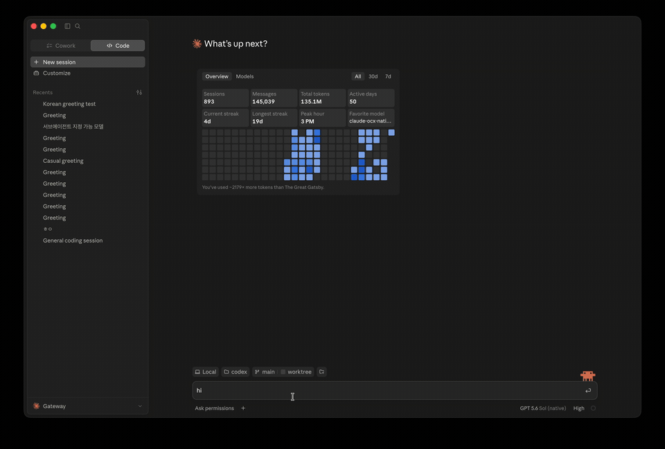

<p align="center">
  
</p>

<h3 align="center">AI 코딩 도구와 모델을 연결하는 하나의 로컬 게이트웨이.</h3>
<p align="center"><b>Codex, Claude Code, Claude Desktop, Grok Build에서 원하는 모델을 사용하고<br>관리형 설정으로 OpenCode, Pi, Qoder, WorkBuddy, Kilo, Cline, T3 Code 등을 연결하세요.</b><br>
<a href="https://easyproxy.me/ko/reference/client-support/">지원하는 모든 도구 보기 →</a></p>

<p align="center">
  <a href="https://github.com/AquilaXk/easyproxy/actions/workflows/ci.yml"></a>
  <a href="https://github.com/AquilaXk/easyproxy/releases/latest"></a>
  <a href="https://github.com/AquilaXk/easyproxy/blob/main/LICENSE"></a>
  
</p>

```bash
npm install -g --allow-scripts=bun easyproxy
epx start
```

<p align="center">
  <a href="https://github.com/AquilaXk/easyproxy/releases/latest/download/EasyProxy-windows-x64.msi"></a>
  &nbsp;
  <a href="https://github.com/AquilaXk/easyproxy/releases/latest/download/EasyProxy-macos-arm64.dmg"></a>
  &nbsp;
  <a href="https://github.com/AquilaXk/easyproxy/releases/latest/download/EasyProxy-linux-x86_64.AppImage"></a>
  <br>
  <sub>macOS 버튼은 Apple Silicon (arm64)용입니다. <a href="https://github.com/AquilaXk/easyproxy/releases/latest/download/EasyProxy-macos-x64.dmg">macOS Intel (.dmg)</a> · <a href="https://github.com/AquilaXk/easyproxy/releases/latest/download/EasyProxy-linux-amd64.deb">Linux (.deb)</a> · <a href="https://github.com/AquilaXk/easyproxy/releases/latest">전체 릴리스 파일 및 체크섬</a></sub>
</p>

<table>
<tr>
<td width="50%" valign="middle">

### Claude Code, 어떤 모델이든

선택기는 Claude Code 그대로입니다. 뒤에서 도는 두뇌만 다릅니다.

</td>
<td width="50%">
  
</td>
</tr>
<tr>
<td width="50%" valign="middle">

### Codex, 어떤 모델이든

프로바이더만 고르면 됩니다 — 같은 워크플로, 다른 두뇌.

</td>
<td width="50%">
  
</td>
</tr>
<tr>
<td width="50%" valign="middle">

### Claude Desktop, 어떤 모델이든

Opus가 답한 다음 작업을 GPT-5.6 Sol 서브에이전트에 넘깁니다.

</td>
<td width="50%">
  
</td>
</tr>
<tr>
<td width="50%" valign="middle">

### Grok Build, 어떤 모델이든

Sol이 세션을 이끌고 Kimi K3 서브에이전트를 호출합니다.

</td>
<td width="50%">
  
</td>
</tr>
</table>

<p align="center">
  <a href="../README.md">English</a> · <a href="README.fr.md">Français</a> · <b>한국어</b> · <a href="README.zh-CN.md">简体中文</a> · <a href="README.zh-TW.md">繁體中文</a> · <a href="README.ru.md">Русский</a> · <a href="README.ja.md">日本語</a> · <a href="README.tr.md">Türkçe</a> · 📖 <a href="https://easyproxy.me/ko/"><b>전체 문서 →</b></a>
</p>

easyproxy는 코딩 도구와 모델 프로바이더를 연결하는 가벼운 로컬 게이트웨이입니다. Responses, Chat Completions, Anthropic Messages API 요청을 받아 프로바이더의 프로토콜로 변환하며 클라이언트와 모델, 프로바이더가 지원하는 경우 스트리밍, 도구 호출, 추론과 이미지를 전달합니다. Claude, Gemini, Grok, GLM, DeepSeek, Kimi, Qwen, Ollama 등의 프로바이더를 Codex, Claude Code, Claude Desktop, Grok Build 및 [클라이언트 지원 페이지](https://easyproxy.me/ko/reference/client-support/)에 나열된 도구와 함께 사용하세요.

## 빠른 시작

### 개인 설치 (CLI)

```bash
npm install -g --allow-scripts=bun easyproxy   # Node 18+; Bun 런타임은 자동으로 번들됩니다
epx start                         # 프록시 + 대시보드: localhost:10100
```

백그라운드로 돌리려면 `epx service`를 쓰세요.

**http://localhost:10100**을 열고 웹 대시보드에서 전부 설정하세요. 프로바이더 추가(내장 40개 이상,
또는 OpenAI 호환 엔드포인트), 모델 선택, 계정 관리까지 모두 여기서 합니다. `epx gui`로 대시보드를 언제든 다시 엽니다.

### 도구 연결

사용 중인 도구를 연결하세요:

| 도구 | 연결 방법 |
|---|---|
| Codex | 대시보드 **Route** 페이지에서 Codex 스위치를 켠 다음 평소처럼 `codex`를 실행하세요. 로컬 리스너에서는 Codex 내장 프로바이더가 프록시를 가리킵니다. 터미널에서는 대시보드에 프로바이더를 추가하기 전에 `epx init`을 실행하고 Codex 프롬프트를 수락하세요. |
| Claude Code | `claude` CLI가 설치된 상태에서 `epx claude`를 실행하세요. 필요하면 프록시를 시작하고 이를 통해 Claude Code를 실행합니다. |
| Claude Desktop | `epx claude desktop`을 실행하세요. 새로 설치할 때는 앱 전체에 게이트웨이 프로필을 설정합니다. 기존 first-party 설정은 유지되며 `epx claude desktop apply --gateway`로 명시적으로 전환할 수 있습니다. [Claude Code 가이드](https://easyproxy.me/ko/guides/claude-code/)를 참조하세요. 전환한 뒤에는 Claude Desktop을 완전히 종료했다가 다시 여세요. |
| Grok Build | 로컬 리스너에서 Grok 통합이 활성화되어 있고 `~/.grok`이 있으면 `epx start`가 모델을 등록합니다. Grok Build에서 `epx-*` 모델을 선택하세요. 원격 설정은 [Grok Build 가이드](https://easyproxy.me/ko/guides/grok-build/)를 참조하세요. 프로바이더를 추가한 뒤에는 프록시를 재시작해(또는 Codex 자동 시작이 활성화된 경우 `epx ensure`를 실행해) 목록을 갱신하세요. |
| 관리형 통합이 있는 도구 | 대시보드의 **Route** 페이지 또는 `epx integration client enable --client <id>`를 사용하세요. |
| 그 밖의 도구 | OpenAI 호환 기본 URL을 `http://localhost:10100/v1`로, 또는 Anthropic 기본 URL을 `http://localhost:10100`으로 설정하세요. |

[클라이언트 지원 페이지](https://easyproxy.me/ko/reference/client-support/)에서 각 도구의 연결 방식과 프로토콜을 확인할 수 있습니다.

<details>
<summary><b>데스크톱 앱 (베타)</b></summary>

데스크톱 앱은 같은 프록시와 대시보드를 네이티브 창에 담은 것으로 트레이와 번들된 `epx`를 포함합니다.
이미 실행 중인 프록시에 붙거나 번들된 프록시를 시작하며 대시보드는 프록시 포트에서 열립니다
(다른 포트를 설정하지 않았다면 **http://localhost:10100**). 플랫폼에 맞는 파일을
[최신 릴리스](https://github.com/AquilaXk/easyproxy/releases/latest)에서 고르세요.

| 플랫폼 | 파일 | 참고 |
|---|---|---|
| macOS 14+ (Apple Silicon) | `EasyProxy-<version>-macos-arm64.dmg` | Apple Developer ID 인증서 설정 시 서명·공증해 배포합니다. 미서명 빌드라면 macOS Gatekeeper에서 **우클릭 → 열기**로 여세요 |
| macOS 14+ (Intel) | `EasyProxy-<version>-macos-x64.dmg` | 별도 Intel x64 빌드입니다. 미서명 빌드의 경우 Gatekeeper 안내가 같습니다 |
| Windows (x64) | `EasyProxy-<version>-windows-x64.msi` | SignPath Foundation을 통해 코드 서명을 도입하고 있습니다 ([코드 서명 정책](https://easyproxy.me/ko/reference/code-signing/)). 서명되기 전 릴리스는 SmartScreen이 한 번 물으면 **추가 정보 → 실행**을 선택하세요 |
| Linux (x86_64) | `EasyProxy-<version>-linux-x86_64.AppImage` 또는 `-linux-amd64.deb` | 트레이는 AppIndicator를 지원하는 데스크톱이 필요합니다 |

릴리스 페이지에서 모든 파일 옆에 `.sha256` 체크섬이 함께 올라갑니다. 버전 번호 없는 파일 이름(`EasyProxy-macos-arm64.dmg`, `EasyProxy-macos-x64.dmg`, `EasyProxy-windows-x64.msi`, `EasyProxy-linux-x86_64.AppImage`, `EasyProxy-linux-amd64.deb`)도 `/releases/latest`에서 같은 빌드를 바로 내려받을 수 있습니다. macOS 14 이상에서는 프록시 상태,
오늘의 사용량, 프로바이더 쿼터를 보여 주는 WidgetKit 확장도 함께 설치됩니다. 위젯이 그리는
스냅샷 모델은 [`app/`](../app)의 `MenuBarCore`에 있습니다. 앱을 직접 빌드하려면 저장소 루트에서
`bun install && bun run build:gui`를 실행한 다음,
`desktop/`에서 macOS라면 `bun install && bun run prepare-sidecar && bun run prepare-widget && bun run build:local`을, Windows와 Linux라면 `bun install && bun run prepare-sidecar && bun run build:local`을 실행하세요. 위젯 빌드 단계는 macOS에서만 돌아갑니다.
[데스크톱 앱 가이드](https://easyproxy.me/ko/guides/desktop-app/)와
[macOS 메뉴 막대 앱 가이드](https://easyproxy.me/ko/guides/macos-menu-bar/)에서 첫 실행 안내를 볼 수 있고
[`CLI_CONSENT.md`](../CLI_CONSENT.md#where-things-are-installed)에는 디스크에 쓰는 모든 항목이 정리되어 있습니다.

</details>

<details>
<summary>Docker Compose</summary>

이 저장소는 digest로 고정하고 root를 쓰지 않는 Compose 빌드를 제공합니다. 빌드는 선택한 Git 스냅샷에서
정식 호환성 매니페스트를 생성하고 검증합니다. 로컬 클론에는 Git과 Docker Compose가 필요하고 원격 Git
컨텍스트에는 Docker Compose가 필요합니다. 어느 쪽도 호스트의 Bun이나 준비 단계는 필요하지 않습니다.
stdin으로 데이터 플레인 토큰을 한 번 초기화하고 허브를 시작하세요:

```bash
git clone https://github.com/AquilaXk/easyproxy.git
cd easyproxy
docker compose build
openssl rand -hex 32 | docker compose run --rm -T hub bun run docker/bootstrap-token.ts
docker compose up -d
curl --fail --silent http://127.0.0.1:10100/healthz
curl --fail --silent http://127.0.0.1:10100/readyz
```

기본 호스트 바인딩은 `127.0.0.1:10100`입니다. 원격 노출은
`EASYPROXY_BIND_ADDRESS=<LAN-or-Tailscale-IP> docker compose up -d`를 명시해야 하며 `0.0.0.0`은
호스트의 모든 인터페이스를 엽니다. 방화벽과 인증된 TLS/tailnet 프론트엔드로 접근을 제한하세요.
생성된 JSON은 추적하지 않습니다. 빌드 컨텍스트에는 `git ls-files`가 인벤토리를 읽는 `.git/index`와
`.git/HEAD`만 들어갑니다. 전체 오브젝트 저장소 대신 약 1 MB이며 읽기 전용 마운트를 통해 빌드 전용
매니페스트 단계에서만 볼 수 있으므로 어떤 `COPY`에도 `.git`이 포함되지 않습니다. 호스트에서 이미 생성한
매니페스트는 검증을 통과해야만 사용하고 그렇지 않으면 빌드가 직접 생성합니다. 빌드는 낡은 매니페스트,
없거나 불일치하는 파일, 여분의 소스 파일, 심볼릭 링크를 거부합니다. 기록된 SHA-256을 빌드 컨텍스트와 복사된 런타임 파일
(`package.json`, `bun.lock`, 특별히 포함된 `scripts/model-metadata.source.json`)과 대조합니다.

원격 Git 컨텍스트에서는 BuildKit이 Git 메타데이터를 유지해야 합니다. 다음 Compose 빌드 조각은 원격
스냅샷을 선택하고 필요한 기본 인자를 전달합니다:

```yaml
services:
  hub:
    pull_policy: build
    build:
      context: https://github.com/AquilaXk/easyproxy.git#main
      dockerfile: Dockerfile
      target: runtime
      args:
        BUILDKIT_CONTEXT_KEEP_GIT_DIR: "1"
```

토큰과 가변 상태는 `epx-state` named volume에 남습니다. 이미지, Compose 파일, 환경, 셸 인자에는
자격 증명을 넣지 않습니다. 프로바이더 설정, 인증된 수락 검사, 원격 관리, 롤백은
[Remote Hub 배포 가이드](https://easyproxy.me/ko/guides/remote-hub/)를 보세요.

</details>

<details>
<summary>소스에서 설치 (최신 main)</summary>

**macOS / Linux:**

```bash
curl -fsSL https://bun.sh/install | bash
git clone -b main https://github.com/AquilaXk/easyproxy.git
cd easyproxy && ~/.bun/bin/bun install
~/.bun/bin/bun run build:gui
~/.bun/bin/bun run src/cli/index.ts start
```

**Windows (PowerShell):**

```powershell
irm bun.sh/install.ps1 | iex
git clone -b main https://github.com/AquilaXk/easyproxy.git
cd easyproxy; bun install
bun run build:gui
bun run src/cli/index.ts start
```

소스 설치는 최신 `main` 브랜치를 실행합니다. 메모리 소유권 패치, 런타임 GC 개선, 아직 npm 패키지에
안 들어간 수정이 여기에 먼저 있습니다.

</details>

<details>
<summary>에이전트용</summary>

```bash
npm install -g --allow-scripts=bun easyproxy
epx start     # 또는 `epx service`
epx init      # 대화형 설정: ~/.easyproxy/config.json을 쓰고 Codex를 연결합니다
```

`epx init`은 프록시를 시작하지 않습니다. 먼저 시작하세요. 나중이어도 순서는 상관없지만
`epx provider add`와 `epx combo set` 같은 헤드리스 명령은 **실행 중인** 프록시와 통신하며
닿지 않으면 nonzero로 종료합니다. `epx status` / `epx doctor` / `epx health`는 실행 상태를 보고합니다.

> **easyproxy를 설치하거나 실행하는 에이전트:**
> [`CLI_CONSENT.md`](../CLI_CONSENT.md)를 읽으세요. 대화형 `epx start`는 이 저장소를 star할지
> 한 번 물을 수 있습니다. 그 결정은 사용자 몫이며 에이전트의 몫이 아닙니다. CLI는 에이전트 실행에서
> 프롬프트를 숨기고 API는 `403 agent_consent_required`로 거부합니다.

</details>

## 지원 플랫폼

| OS | 지원 상태 | 서비스 관리자 | 데스크톱 앱 (베타) |
|---|---|---|---|
| macOS (arm64 / x64) | 완전 지원 | launchd | `arm64` / `x64` `.dmg` |
| Linux (x64 / arm64) | 완전 지원 | systemd (user unit) | x86_64 `.AppImage` / `.deb` |
| Windows (x64) | 완전 지원 | Task Scheduler (숨김) / 선택적 네이티브 서비스 (`--native`, WinSW) | x64 `.msi` |

CLI 설치에는 [Node](https://nodejs.org) 18 이상이 필요하고 데스크톱 앱은 Node와 Bun 모두 필요 없습니다. Bun 런타임은 `npm install` 때 번들되므로 따로 설치할
필요가 없고 Windows에서도 WSL이 필요 없습니다. npm이 번들 런타임의 설치 스크립트를 막았다면
[설치 문서](https://easyproxy.me/ko/getting-started/installation/)를 보세요.

## 주요 기능

- **Codex, Claude Code, Claude Desktop, Grok Build에서 어떤 LLM이든** — 내장 프로바이더 40개 이상,
  각각 네이티브 UI를 유지합니다.
- **Combos** — failover나 가중 round-robin으로 프로바이더를 묶는 가상 모델 id 하나입니다.
  [combo 가이드](https://easyproxy.me/ko/guides/combos/)를 확인하세요.
- **어떤 모델에서든 서브에이전트** — Codex 서브에이전트 선택기에 라우팅 모델을 올리고 v1/v2
  표면 제어와 fallback 체인을 둡니다.
  [서브에이전트 가이드](https://easyproxy.me/ko/guides/sub-agent-surface/)를 보세요.
- **한 번 로그인하면 API 키는 생략** — xAI, Anthropic, Kimi는 OAuth. 아니면 `codex login`을
  forward하거나 키를 붙여넣거나 `${ENV_VAR}` 참조를 씁니다.
- **웹 검색·비전 sidecar** — OpenAI가 아닌 모델도 ChatGPT 로그인 위의 sidecar로 실제 웹 검색과
  이미지 이해를 씁니다.
- **무슨 일이 일어나는지 보이게** — 대시보드가 프로바이더, OAuth 상태, 모델 선택, cache 토큰 수가
  찍힌 실시간 요청 로그를 보여줍니다.
- **깔끔한 종료, 잔여물 제로** — `epx stop`이 Codex를 원래 설정으로 되돌립니다.
- **한도가 정해진 메모리 소유권** — 오래 사는 cache, ring buffer, 프로토콜 변환 저장소마다 정해진 cap,
  바이트 예산, 또는 활성 reconciliation이 있습니다. config를 다시 로드한 뒤 상한 없는 `Map`이나
  `Set`은 남지 않습니다.

<details>
<summary>메모리 소유권 상세</summary>

EasyProxy는 프로세스가 붙잡고 있는 상태를 아래 항목에서 추적합니다. 각각에 문서화된 한도가 있습니다:

- **유지 저장소 15개**(요청 로그, debug ring, image cache, model cache, vision 설명, cursor blob,
  responses continuation 등)는 바이트 단위로 집계되며 앱이 소유한 메모리 예산(기본 256 MiB)이
  eviction합니다. 단, native control replay 저장소는 고정되어 eviction되지 않습니다.
- **관측 버퍼 4개**(translator accumulator, image/OAuth/Grok tail)는 진행 중 바이트 압력을 감시만
  하고 eviction하지 않습니다.
- **state-store 등록 32개**는 만료 sweep(60초 간격)과 config-generation reconciliation을 돌려
  낡은 프로바이더/계정 키를 지웁니다.
- **경로·fingerprint 메모**(워크스페이스 메타데이터, hardened identity, 설치 salt, mode-hint
  capability)는 삽입 순서 LRU cap(8–128개)을 씁니다.
- **model-cache generation tombstone**은 reconciliation 뒤에 삭제됩니다. 전역 generation을 올려서,
  진행 중이던 낡은 discovery가 지워진 프로바이더를 다시 채우지 못하게 합니다.
- **Lab event-id 중복 제거**는 디스크 ledger lock 아래에서 돌며 프로세스 RAM 인덱스는 없습니다.

관리자 토큰으로 `GET /api/system/memory`를 호출하면 현재 유지 바이트, eviction 카운터, watchdog
샘플을 볼 수 있습니다.

</details>

## 모델 라우팅

`provider/model` 구문으로 설정해 둔 프로바이더와 모델을 지정합니다:

```bash
codex -m "anthropic/claude-opus-5" "이 스택 트레이스를 설명해 줘"
codex -m "google/gemini-3-pro" "auth.ts의 유닛 테스트를 작성해 줘"
codex -m "ollama/llama3" "이 함수를 리팩터링해 줘"
```

`provider/` 접두사를 빼면 기본 프로바이더를 쓰거나 모델명 패턴으로 자동 매칭합니다. `/`가 들어 있는
프로바이더 모델 id는 안쪽 슬래시를 `-`로 alias해서 노출하고 슬래시를 그대로 둔 원본 형태도 계속
동작합니다. 자세한 내용은 [모델 라우팅 문서](https://easyproxy.me/ko/guides/model-routing/)를 보세요.

### JEV Auto 라우팅 (선택)

TypeSafe JEV는 명시적으로 켠 Combo에서 첫 모델과 reasoning effort를 고를 수 있습니다. 일반 모델
선택기와 직접 라우트는 그대로입니다. 자격 증명은 `epx login jev`, **Providers → TypeSafe JEV → Add API key**,
또는 `TYPESAFE_API_KEY`/`JEV_API_KEY`로 추가합니다. 그다음 **Models → Combos → Create JEV Auto**에서
허용할 대상 모델을 고르고 대상마다 JEV가 고를 수 있는 effort를 체크하세요. effort 설정을 건드리지
않은 대상은 그 모델이 현재 광고하는 effort를 모두 허용합니다.

JEV는 `jev-auto`에서만, 논리적 모델 호출당 한 번만 호출됩니다. 자격 증명이 없거나 네트워크가
실패하거나 결정이 잘못되면 현재 적격인 첫 대상으로 fail-open하며 호출자 취소는 여전히 요청을
취소합니다. 자동 테스트는 모의 TypeSafe 엔드포인트를 쓰며 실제 JEV 계정은 검증하지 않습니다.

JEV Combo는 키가 필요 없는 Ollama `tev1` 같은 자체 호스팅 결정 모델을 대신 쓸 수도 있습니다.
`baseUrl`이 전체 `/v1/systemone` 엔드포인트인 `jev-decision` 프로바이더를 추가하고 Combo의
`decisionProvider`에 지정하세요. TypeSafe 자격 증명은 그곳으로 전송되지 않습니다. 자세한 내용은
[자체 호스팅 결정 모델](https://easyproxy.me/ko/guides/combos/)을 보세요.

## 프로바이더 및 adapter

OpenAI (ChatGPT 로그인 또는 API 키), Anthropic, Google Gemini, xAI, Kimi, Azure OpenAI, Ollama
(로컬 + Cloud), Cursor (experimental), OpenAI 호환 엔드포인트 전부 — 여기에 DeepSeek,
Groq, OpenRouter, OpenGateway, Together, Fireworks, Cerebras, Mistral, Hugging Face, NVIDIA NIM, MiniMax,
Qwen Cloud, Qoder Global과 CN (공식 PAT + CLI), SiliconFlow 등이 더 있습니다. 전체 목록은 `epx init` 또는
[프로바이더 문서](https://easyproxy.me/ko/guides/providers/)에서 확인하세요.

## CLI

```bash
epx init                       # 대화형 설정 (config 작성, Codex 연결, shim 제안)
epx start [--port 10100] [--socks5 [host:port] | --socks5-off]  # SOCKS5 기본값은 socks5://127.0.0.1:10808
epx stop                       # 중지 + 네이티브 Codex 복원
epx service [install|repair|restart|start|stop|status|uninstall|remove]  # 백그라운드 서비스
epx codex-shim install         # `codex`가 뜰 때마다 프록시를 필요 시 시작
epx health [--json]            # 프록시가 지금 살아 있는지 확인
epx ready [--json] [--wait [--timeout <seconds>]]  # 동기화 후 준비 상태 확인
epx status                     # 프록시가 실행 중인지 확인합니다
epx gui                        # 웹 대시보드 열기
epx provider <...>             # 프로바이더 관리 (list/add/edit/test/remove)
epx account <...>              # ChatGPT 계정 및 API-key 풀 관리
epx combo <...>                # failover / round-robin combo 관리
epx v2 <...>                   # 멀티에이전트 v1/v2 표면 제어
epx update [--tag preview]     # easyproxy 업데이트
```

선호 포트가 사용 중이면 다른 포트로 옮겨가지 않고 시작을 중단한 뒤 해당 포트의 점유자를 알려줍니다. 따라서 기존
프록시 옆에 두 번째 프록시가 실행된 채 남을 수 없습니다. 포트를 비우거나 `--port`로 다른 포트를 지정하세요.
전체 레퍼런스: [CLI 문서](https://easyproxy.me/ko/reference/cli/).

### 상태 확인과 준비

`GET /healthz`는 프록시가 지금 살아 있는지 바로 알려줍니다. 인증이 필요 없는 `GET /readyz`는 동기화가
끝난 뒤의 준비 상태를 민감 정보를 뺀 JSON identity `{service, version, uptime, pid, port, status}`로
돌려줍니다. `status`가 `ready`이면 `200`, `pending`과 최종 `failed`는 `Retry-After: 1`과 함께 `503`입니다.

`epx ready [--json] [--wait [--timeout <seconds>]]`는 기본으로 한 번 probe합니다. `--wait`는 기본 최대
45초 동안 폴링하되 최종 `failed`를 보면 즉시 종료합니다. `--timeout <seconds>`는 1–300초 한도를 정하고
`--wait`가 필요하며 양의 정수만 받습니다. CLI `--json` 출력은 `{ready, status, pid, port}`이고
`status`는 `ready`, `pending`, `failed`, `unreachable`입니다.

| 종료 코드 | 결과 |
| --- | --- |
| `0` | 준비됨 |
| `1` | 준비되지 않음: pending, failed, timeout, unreachable |
| `64` | 잘못된 인자 |

`/readyz`가 없는 옛 프록시는 `unreachable`로 fail-closed되어 종료 코드 1을 내고 `epx health`는
그대로 호환됩니다.

### 자동 시작: service vs shim

항상 켜 두고 크래시 때 다시 살릴 프록시면 **service** (`epx service`)를 쓰세요. 백그라운드 데몬 없이
가볍게 필요할 때만 켜려면 **shim** (`epx codex-shim install`)을 쓰세요. 제거는
`epx service uninstall` / `epx codex-shim uninstall`입니다.

### 삭제

```bash
epx uninstall                  # 중지, service/shim 제거, 네이티브 Codex 복원, 상태 정리
npm uninstall -g easyproxy
```

## 원격 접근

기본적으로 easyproxy는 `127.0.0.1`에 바인딩되며 추가 인증이 필요 없습니다. 루프백 밖으로 바인딩하면
(`"hostname": "0.0.0.0"`) bearer 토큰이 **필수**입니다. `EASYPROXY_API_AUTH_TOKEN`이 없으면 프록시가
시작을 거부하고 모든 클라이언트 요청은 `x-easyproxy-api-key`로 토큰을 실어야 합니다. 자세한 내용은
[설정 레퍼런스](https://easyproxy.me/ko/reference/configuration/)를 보세요.

## 고급 사용

파워 유저를 위한 셀프 호스팅 옵션입니다. 켜기 전에 각 프로바이더의 약관을 확인하세요.

### ChatGPT 계정 풀

easyproxy는 Codex 인증용 **ChatGPT 계정 풀**도 관리합니다. ChatGPT / Codex 계정을 여러 개 넣고
대시보드에서 5시간 / 주간 / 30일 쿼터를 갱신합니다. 쿼터 라우팅을 켜면 새 세션은 사용량이 가장 적은
정상 계정을 쓰고 round-robin과 fill-first는 각자 정책을 따릅니다. 기존 Codex 스레드는 기본적으로
시작한 계정에 붙어 있어서 긴 SSH·tmux·모바일 세션이 대화 도중에 계정을 바꾸지 않습니다. 다만 쿼터
재평가, failover, 계정 제외, affinity 만료, 401/403·429 복구가 일어나면 다시 묶일 수 있습니다.
Codex Desktop 로그인처럼 다른 계정이 소진된 뒤에만 쓰고 싶은 계정이 있으면 계정에 선택 순서를 지정하세요.

- **ChatGPT 계정 풀** — 스레드 affinity, 쿼터 기반 자동 전환, cooldown과 fail-closed 인증 처리.

  > **프로바이더 정책 안내:** 계정 풀은 라우팅과 운영 복원력만을 위한 것이며 프로바이더 rate limit,
  > 제재, 정지, 기타 계정 조치로부터의 보호를 보장하지 않습니다. EasyProxy는 프로바이더 한도를
  > 우회하려고 추가 계정을 쓰거나 계정 자격 증명을 사람들끼리 공유하는 행위를 지지하지 않습니다.
  > 각 프로바이더의 현행 약관을 지키는 책임은 사용자에게 있습니다.
  > [Codex Auth 계정 풀 가이드](https://easyproxy.me/ko/guides/web-dashboard/)와
  > [OpenAI 이용 약관](https://openai.com/policies/terms-of-use/)을 확인하세요.

## 문서

공개 문서(설치, 프로바이더, 라우팅, combo, 서브에이전트, sidecar, 통합, CLI/설정/management-API
레퍼런스)는 [`docs-site/`](../docs-site)에서 빌드되어 **[easyproxy.me](https://easyproxy.me/ko/)**에
게시됩니다.

유지보수용 source-of-truth 노트는 [`structure/`](../structure)에, 보안 보고는 [`SECURITY.md`](../SECURITY.md)에 있습니다.
아직 공개되지 않은 취약점은 공개 이슈가 아니라
[GitHub 비공개 취약점 보고](https://github.com/AquilaXk/easyproxy/security/advisories/new)로
비공개 제보하세요.
기술 창구는 이 양식뿐이고 보안 전용 메일 주소는 없습니다. 이후 논의도 비공개 보고 안에서 이어가세요.
공개 이슈에는 일정 조율 정도만 올릴 수 있고 취약점 내용은 올릴 수 없습니다. 접수 확인은 트리아지가
아니며 최초 응답 시한도 약속하지 않습니다.

## 개발

소스 개발에는 `PATH`에 `bun` CLI가 있어야 합니다. 배포된 npm 패키지는 설치된 `epx` 명령용 Bun
런타임을 번들하며 package script도 이 번들 의존성에서 Bun을 선택할 수 있습니다.

```bash
git clone https://github.com/AquilaXk/easyproxy.git
cd easyproxy
bun install
bun run typecheck
bun run test
```

## 코드 서명 정책 (Code signing policy)

Windows 바이너리에 Authenticode 서명을 도입하고 있습니다. 도입 현황, 서명 확인 방법, 전체 정책은 [Windows 코드 서명 가이드](https://easyproxy.me/ko/reference/code-signing/)에 있습니다.

Free code signing provided by [SignPath.io](https://about.signpath.io/), certificate by [SignPath Foundation](https://signpath.org/).

- Committers and reviewers: [AquilaXk](https://github.com/AquilaXk)
- Approvers: [AquilaXk](https://github.com/AquilaXk)
- Privacy: easyproxy sends one anonymous daily usage summary (a per-day install hash that changes daily, version, release channel, platform, install channel, provider kind, coarse model family, active minutes and request, token and error counts; never prompts, model outputs, keys, accounts, hostnames or paths) to telemetry.easyproxy.me, and only after the person installing or operating it has seen the notice in the dashboard or an interactive CLI prompt and has not declined. It can be turned off in that notice, in the Windows installer ("Send anonymous usage statistics", checked by default), in Proxy details, or with epx telemetry disable, EPX_TELEMETRY=0 or DO_NOT_TRACK=1. Only project-wide aggregates of this anonymous data are public. A separate public leaderboard profile is off unless you connect one yourself (dashboard Home or epx telemetry profile connect); it shares only a chosen handle, display name and colour and your daily request, token and model-family totals, never your anonymous telemetry ID, and disconnecting deletes it. Everything else goes only to the providers and services you configure. See the [telemetry guide](https://easyproxy.me/ko/guides/telemetry/).

## 면책 조항

easyproxy는 커뮤니티가 유지하는 독립 프로젝트이며 **OpenAI, Anthropic 등 어떤 프로바이더와도 제휴하거나 보증을 받지 않습니다.**

일부 프로바이더 — 특히 Anthropic (Claude) — 는 서드파티 프록시로 API 트래픽을 라우팅하는 계정을 정지하거나 제한할 수 있습니다. **사용 책임은 본인에게 있습니다 (UAYOR).** 프로바이더를 연결하기 전에 해당 서비스 약관에서 프록시 기반 접근이 허용되는지 확인하세요. easyproxy 유지보수자는 업스트림 프로바이더가 취한 계정 조치에 책임을 지지 않습니다.

## 피드백

사용 중 불편한 점이나 오류가 있으면 [GitHub Issues](https://github.com/AquilaXk/easyproxy/issues)에 등록하거나 [문서](https://easyproxy.me/ko/)를 확인해 주세요.

## 라이선스

MIT
