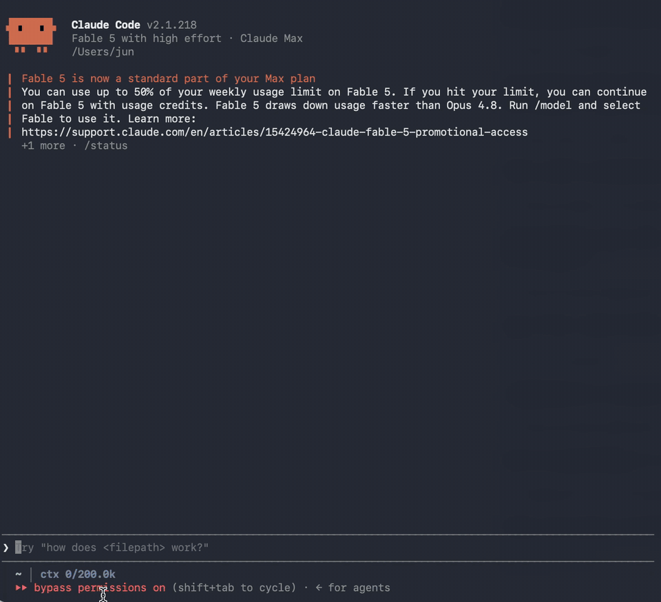
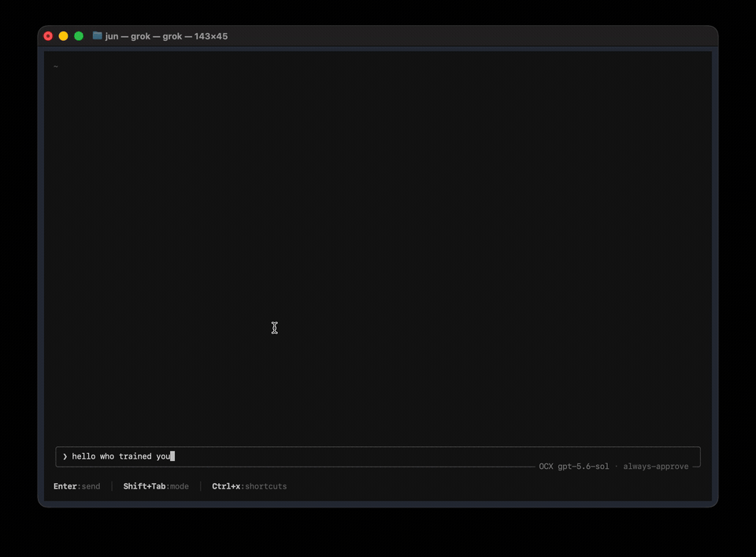

<p align="center">
  
</p>

<h1 align="center">EasyProxy</h1>

<p align="center">
  連接你的 AI 程式開發工具與模型的統一本機閘道。
  <br>
  在 Codex、Claude Code、Claude Desktop 和 Grok Build 中使用你選擇的模型，或透過受管理的設定連接 OpenCode、Pi、Qoder、WorkBuddy、Kilo、Cline、T3 Code 等工具。
  <br>
  <a href="#quick-start"><b>安裝 ↓</b></a> · <a href="https://easyproxy.me/zh-tw/reference/client-support/"><b>查看支援的工具 →</b></a>
</p>

<p align="center">
  <a href="https://github.com/AquilaXk/easyproxy/releases/latest/download/EasyProxy-windows-x64.msi"></a>
  &nbsp;
  <a href="https://github.com/AquilaXk/easyproxy/releases/latest/download/EasyProxy-macos-arm64.dmg"></a>
  &nbsp;
  <a href="https://github.com/AquilaXk/easyproxy/releases/latest/download/EasyProxy-linux-x86_64.AppImage"></a>
  <br>
  <sub>macOS 按鈕適用於 Apple Silicon (arm64)。<a href="https://github.com/AquilaXk/easyproxy/releases/latest/download/EasyProxy-macos-x64.dmg">macOS Intel (.dmg)</a> · <a href="https://github.com/AquilaXk/easyproxy/releases/latest/download/EasyProxy-linux-amd64.deb">Linux (.deb)</a> · <a href="https://github.com/AquilaXk/easyproxy/releases/latest">全部發行檔案與校驗和</a></sub>
</p>

<p align="center">
  <a href="https://github.com/AquilaXk/easyproxy/actions/workflows/ci.yml"></a>
  <a href="https://github.com/AquilaXk/easyproxy/releases/latest"></a>
  <a href="https://github.com/AquilaXk/easyproxy/blob/main/LICENSE"></a>
  = 18" src="https://img.shields.io/badge/node-%3E%3D18-339933?style=flat-square&logo=node.js&logoColor=white">
  <a href="https://github.com/sponsors/AquilaXk"></a>
</p>

<p align="center">
  <a href="../README.md">English</a> · <a href="README.fr.md">Français</a> · <a href="README.ko.md">한국어</a> · <a href="README.zh-CN.md">简体中文</a> · <b>繁體中文</b> · <a href="README.ru.md">Русский</a> · <a href="README.ja.md">日本語</a> · <a href="README.tr.md">Türkçe</a> · 📖 <a href="https://easyproxy.me/zh-tw/"><b>完整文件 →</b></a>
</p>

```bash
npm install -g --allow-scripts=bun easyproxy
epx start
```

<table>
<tr>
<td width="50%" valign="middle">

### Claude Code，執行任意模型

選擇器維持 Claude Code 原生介面，背後的模型由你自由指定。

</td>
<td width="50%">
  
</td>
</tr>
<tr>
<td width="50%" valign="middle">

### Codex，執行任意模型

選好供應商即可延續熟悉的工作流程。

</td>
<td width="50%">
  
</td>
</tr>
<tr>
<td width="50%" valign="middle">

### Claude Desktop，執行任意模型

Opus 先回答，再把任務交給 GPT-5.6 Sol 子代理。

</td>
<td width="50%">
  
</td>
</tr>
<tr>
<td width="50%" valign="middle">

### Grok Build，執行任意模型

Sol 主導會話，並呼叫 Kimi K3 子代理。

</td>
<td width="50%">
  
</td>
</tr>
</table>

easyproxy 是連接程式開發工具與模型供應商的輕量級本機閘道。它接收 Responses、Chat Completions 和 Anthropic Messages API 請求，並轉換成供應商使用的協定；在用戶端、模型和供應商支援的情況下，傳遞串流、工具呼叫、推理和影像。你可以在 Codex、Claude Code、Claude Desktop、Grok Build 及[用戶端支援頁面](https://easyproxy.me/zh-tw/reference/client-support/)列出的工具中使用 Claude、Gemini、Grok、GLM、DeepSeek、Kimi、Qwen、Ollama 等供應商。

## 亮點

- **在 Codex、Claude Code、Claude Desktop 與 Grok Build 使用任何 LLM。** 開箱即用 40+ 供應商，各自保留原生 UI。
- **Combo。** 一個虛擬模型 id，可在供應商之間 failover 或加權 round-robin。詳見 [combo 指南](https://easyproxy.me/zh-tw/guides/combos/)。
- **任何模型上的子代理。** 讓路由模型出現在 Codex 的子代理選擇器，含 v1/v2 介面控制與 fallback 鏈。詳見[子代理指南](https://easyproxy.me/zh-tw/guides/sub-agent-surface/)。
- **登入一次，或直接帶入 API 金鑰。** xAI、Anthropic、Kimi 支援 OAuth；也可轉發 `codex login`、貼上金鑰，或使用 `${ENV_VAR}` 引用。
- **網頁搜尋與視覺 sidecar。** 非 OpenAI 模型可透過掛在 ChatGPT 登入上的 sidecar，獲得真正的網頁搜尋與圖片理解能力。
- **即時儀表板與日誌。** 儀表板顯示供應商、OAuth 狀態、模型選擇，以及含快取 token 計數的即時請求日誌。
- **乾淨退出。** `epx stop` 把 Codex 還原成原始設定。
- **有界記憶體所有權。** 每個長生命週期的快取、環形緩衝區與協議翻譯儲存都有有限上限、位元組預算或主動調和。設定重新載入後，不會留下無界的 `Map` 或 `Set`。

<details>
<summary>記憶體所有權細節</summary>

EasyProxy 在下列類別中追蹤行程保留狀態。每一類都有文件化的上限：

- **15 個保留儲存**（請求日誌、除錯環形緩衝、圖片快取、模型快取、視覺
  描述、cursor blob、responses 延續等）以位元組計帳，並由
  應用程式自己的記憶體預算淘汰（預設 256 MiB）；其中 native control replay
  儲存為固定，不會被淘汰。
- **4 個觀測緩衝區**（翻譯累加器、image/OAuth/Grok 尾端）會
  監控進行中的位元組壓力，但不淘汰。
- **32 個狀態儲存註冊**負責到期清掃（間隔 60 秒）與
  設定世代調和，以移除過期的供應商／帳號鍵。
- **路徑與指紋 memo**（工作區中繼資料、強化身分、安裝
  salt、mode-hint 能力）使用插入順序 LRU 上限（8–128 筆）。
- **模型快取世代 tombstone** 在調和後刪除；全域
  世代遞增可避免過期、進行中的探索把已移除的供應商填回來。
- **Lab event-id 去重**在磁碟帳本鎖下執行，行程層級沒有
  RAM 索引。

執行 `GET /api/system/memory`（帶管理權杖）可檢視目前保留的位元組、
淘汰計數與 watchdog 樣本。

</details>

<a id="quick-start"></a>

## 快速開始

### 個人安裝（CLI）

```bash
npm install -g --allow-scripts=bun easyproxy   # Node 18+；Bun 執行環境會自動打包
epx start                         # 代理 + 儀表板位於 localhost:10100
```

用 `epx service` 在背景執行。

開啟 **http://localhost:10100**，在網頁儀表板完成所有設定：新增供應商（40+ 內建，或任何 OpenAI 相容端點）、挑選模型、管理帳號。隨時可用 `epx gui` 重新開啟儀表板。

### 連接你的工具

連接你正在使用的工具：

| 工具 | 連接方式 |
|---|---|
| Codex | 開啟儀表板 **Route** 頁面的 Codex 開關，然後照常執行 `codex`。在本機監聽時，這會讓 Codex 內建供應商指向代理。使用終端機時，請在儀表板新增供應商之前執行 `epx init` 並接受其 Codex 提示。 |
| Claude Code | 安裝 `claude` CLI 後執行 `epx claude`。它會在需要時啟動代理，並透過代理啟動 Claude Code。 |
| Claude Desktop | 執行 `epx claude desktop`。全新安裝時會為整個應用程式設定閘道設定檔；既有的 first-party 設定會保留，可執行 `epx claude desktop apply --gateway` 明確切換。詳見 [Claude Code 指南](https://easyproxy.me/zh-tw/guides/claude-code/)。切換後請完全結束並重新開啟 Claude Desktop。 |
| Grok Build | 在本機監聽且啟用 Grok 整合時，若 `~/.grok` 存在，`epx start` 會註冊模型；在 Grok Build 中選擇 `epx-*` 模型。遠端設定請參見 [Grok Build 指南](https://easyproxy.me/zh-tw/guides/grok-build/)。新增供應商後，重新啟動代理（或在啟用 Codex 自動啟動時執行 `epx ensure`）以更新清單。 |
| 具備受管理整合的工具 | 使用儀表板的 **Route** 頁面，或執行 `epx integration client enable --client <id>`。 |
| 其他工具 | 將自訂 OpenAI 相容基本 URL 設為 `http://localhost:10100/v1`，或將 Anthropic 基本 URL 設為 `http://localhost:10100`。 |

[用戶端支援頁面](https://easyproxy.me/zh-tw/reference/client-support/)列出各工具的連接方式與使用的協定。

<details>
<summary><b>桌面應用程式（Beta）</b></summary>

桌面應用程式是同一套代理與儀表板的原生視窗版本，附系統匣與內建的 `epx`。
它會接上已在執行的代理，或啟動內建的那一個；儀表板仍使用代理的連接埠
（除非你設定了其他連接埠，否則為 **http://localhost:10100**）。請從
[最新發行版](https://github.com/AquilaXk/easyproxy/releases/latest)挑選適合你平台的檔案：

| 平台 | 檔案 | 說明 |
|---|---|---|
| macOS 14+（Apple Silicon） | `EasyProxy-<version>-macos-arm64.dmg` | 設定 Apple Developer ID 憑證後會進行簽章與公證；在此之前為未簽章版本（macOS Gatekeeper 可能需 **右鍵 → 打開**） |
| macOS 14+（Intel） | `EasyProxy-<version>-macos-x64.dmg` | 獨立 Intel x64 建置；未簽章時適用相同 Gatekeeper 說明 |
| Windows（x64） | `EasyProxy-<version>-windows-x64.msi` | 正透過 SignPath Foundation 推出程式碼簽章（[程式碼簽章政策](https://easyproxy.me/zh-tw/reference/code-signing/)）；在版本簽章之前，SmartScreen 會詢問一次，選擇 **More info → Run anyway** |
| Linux（x86_64） | `EasyProxy-<version>-linux-x86_64.AppImage` 或 `-linux-amd64.deb` | 系統匣需要支援 AppIndicator 的桌面環境 |

每個檔案在發行頁面上都附有 `.sha256`，且不含版本號的安裝檔別名（`EasyProxy-macos-arm64.dmg`、`EasyProxy-macos-x64.dmg`、`EasyProxy-windows-x64.msi`、`EasyProxy-linux-x86_64.AppImage`、`EasyProxy-linux-amd64.deb`）在 `/releases/latest` 指向同一批經過驗證的建置產物。在 macOS 14+ 上，應用程式還附帶
WidgetKit 擴充套件，可顯示代理狀態、今日用量與供應商配額；它所呈現的快照模型位於
[`app/`](../app)（`MenuBarCore`）。若要自行建置應用程式，先在儲存庫根目錄執行
`bun install && bun run build:gui`，再於
`desktop/` 執行：macOS 上用 `bun install && bun run prepare-sidecar && bun run prepare-widget && bun run build:local`，Windows 與 Linux 上用 `bun install && bun run prepare-sidecar && bun run build:local`（小工具步驟只能在 macOS 上執行）。
[桌面應用程式指南](https://easyproxy.me/zh-tw/guides/desktop-app/) 與
[macOS 選單列應用程式指南](https://easyproxy.me/zh-tw/guides/macos-menu-bar/) 涵蓋首次啟動，
[`CLI_CONSENT.md`](../CLI_CONSENT.md#where-things-are-installed) 列出所有寫入磁碟的內容。

</details>

<details>
<summary><b>支援平台</b></summary>

| 作業系統 | 狀態 | 服務管理員 | 桌面應用程式（Beta） |
|---|---|---|---|
| macOS (arm64 / x64) | 完整支援 | launchd | `arm64` / `x64` `.dmg` |
| Linux (x64 / arm64) | 完整支援 | systemd（使用者單元） | x86_64 `.AppImage` / `.deb` |
| Windows (x64) | 完整支援 | Task Scheduler（隱藏）／可選原生服務（`--native`、WinSW） | x64 `.msi` |

CLI 安裝需要 [Node](https://nodejs.org) 18+；桌面應用程式則不需要 Node 或 Bun。Bun 執行環境在 `npm install` 時一併打包，不必另外安裝 Bun，Windows 也不需要 WSL。若 npm 攔截了打包執行環境的安裝腳本，請見[安裝文件](https://easyproxy.me/zh-tw/getting-started/installation/)。

</details>

<details>
<summary><b>Docker Compose</b></summary>

本儲存庫提供 digest 釘選、非 root 的 Compose 建置。建置會根據選定的 Git 快照自行產生並驗證
權威相容性清單。本機 clone 需要 Git 與 Docker Compose；遠端 Git context 需要 Docker Compose。
兩種方式都不需要主機上的 Bun，也不需要準備步驟。透過 stdin 初始化一次資料平面權杖並啟動 hub：

```bash
git clone https://github.com/AquilaXk/easyproxy.git
cd easyproxy
docker compose build
openssl rand -hex 32 | docker compose run --rm -T hub bun run docker/bootstrap-token.ts
docker compose up -d
curl --fail --silent http://127.0.0.1:10100/healthz
curl --fail --silent http://127.0.0.1:10100/readyz
```

預設主機綁定為 `127.0.0.1:10100`。遠端公開必須明確指定
`EASYPROXY_BIND_ADDRESS=<LAN-or-Tailscale-IP> docker compose up -d`；`0.0.0.0` 會加入
所有主機介面。請用防火牆與已認證的 TLS／tailnet 前端限制存取。
產生的 JSON 不會被追蹤。建置 context 只會納入 `.git/index` 與 `.git/HEAD`，也就是
`git ls-files` 讀取的清單；大小約為 1 MB，而不是完整的 object store。這些檔案只能透過唯讀 mount
在建置專用的 manifest 階段看到，因此沒有任何 `COPY` 會包含 `.git`。主機上已有的 manifest 只有在
通過驗證後才會接受；否則建置會自行產生。建置會拒絕過期清單、缺少或不相符的檔案、多餘原始碼檔案，以及符號連結。
它會核對建置上下文與複製進去的執行檔案上每一筆記錄的 SHA-256，包括
`package.json`、`bun.lock`，以及特別納入的 `scripts/model-metadata.source.json`。

遠端 Git context 需要 BuildKit 保留 Git metadata。以下 Compose 建置片段會選擇遠端快照，
並傳入所需的內建參數：

```yaml
services:
  hub:
    pull_policy: build
    build:
      context: https://github.com/AquilaXk/easyproxy.git#main
      dockerfile: Dockerfile
      target: runtime
      args:
        BUILDKIT_CONTEXT_KEEP_GIT_DIR: "1"
```

權杖與可變狀態留在名為 `epx-state` 的 volume；映像、Compose 檔、環境變數或 shell 引數都不會放入憑證。見
[Remote Hub 部署指南](https://easyproxy.me/zh-tw/guides/remote-hub/) 以了解供應商
設定、已認證的驗收檢查、遠端管理與還原。

</details>

<details>
<summary><b>從原始碼安裝（最新 main）</b></summary>

**macOS / Linux：**

```bash
curl -fsSL https://bun.sh/install | bash
git clone -b main https://github.com/AquilaXk/easyproxy.git
cd easyproxy && ~/.bun/bin/bun install
~/.bun/bin/bun run build:gui
~/.bun/bin/bun run src/cli/index.ts start
```

**Windows (PowerShell)：**

```powershell
irm bun.sh/install.ps1 | iex
git clone -b main https://github.com/AquilaXk/easyproxy.git
cd easyproxy; bun install
bun run build:gui
bun run src/cli/index.ts start
```

從原始碼安裝會跑最新的 `main` 分支。記憶體所有權
修補、執行環境 GC 改善，以及尚未發布的修正，都會比 npm 套件更早在這裡出現。

</details>

<details>
<summary><b>給 agent 使用</b></summary>

```bash
npm install -g --allow-scripts=bun easyproxy
epx start     # 或 `epx service`
epx init      # 互動式設定：寫入 ~/.easyproxy/config.json 並接上 Codex
```

`epx init` 永遠不會啟動代理；請先啟動（或之後再啟動，順序都可以，不過像
`epx provider add` 與 `epx combo set` 這類無介面命令會跟**正在執行**的代理通訊，連不上就以非零結束碼結束）。`epx status` / `epx doctor` / `epx health` 回報執行狀態。

> **正在安裝或執行 easyproxy 的 agent：** 請讀
> [`CLI_CONSENT.md`](../CLI_CONSENT.md)。互動式 `epx start` 可能會問一次要不要
> 為此儲存庫按星。那是使用者的決定，絕不是 agent 的。CLI 會在 agent 驅動的執行中隱藏該
> 提示，API 則以 `403 agent_consent_required` 拒絕。

</details>

## 模型路由

用 `provider/model` 語法指定任何已設定的供應商與模型：

```bash
codex -m "anthropic/claude-opus-5" "解釋這個 stack trace"
codex -m "google/gemini-3-pro" "為 auth.ts 寫單元測試"
codex -m "ollama/llama3" "重構這個 function"
```

省略 `provider/` 字首時，會使用預設供應商，或依模型名模式自動匹配。
供應商模型 id 若含 `/`，對外會把內部斜線別名成 `-`；原始
全斜線形式同樣可用。細節：[模型路由文件](https://easyproxy.me/zh-tw/guides/model-routing/)。

<details>
<summary><b>JEV Auto 路由（選用）</b></summary>

TypeSafe JEV 可以為明確啟用的 Combo 選擇第一個模型與推理強度，一般模型選擇器與所有直接路由保持不變。
透過 `epx login jev`、**Providers → TypeSafe JEV → Add API key** 或 `TYPESAFE_API_KEY`/`JEV_API_KEY`
加入憑證。接著開啟 **Models → Combos → Create JEV Auto**，選擇允許的目標模型，並為每個目標勾選
JEV 可選的推理強度。未變更強度設定的目標會允許該模型目前宣告的所有強度。

JEV 只用於 `jev-auto`，且每次邏輯模型呼叫只諮詢一次。缺少憑證、網路失敗或決策無效時，會 fail-open
到目前第一個可用目標；呼叫端取消仍會取消請求。自動化測試使用模擬的 TypeSafe 端點，
不驗證真實的 JEV 帳戶。

JEV Combo 也可以改用自架的決策模型，例如無需金鑰的 Ollama `tev1`：新增一個 `baseUrl` 為完整
`/v1/systemone` 端點的 `jev-decision` 供應商，並將其設為 Combo 的 `decisionProvider`。TypeSafe 憑證
絕不會傳送到該端點。詳見[自架決策模型](https://easyproxy.me/zh-tw/guides/combos/)。

</details>

## 供應商與 adapter

OpenAI（ChatGPT 登入或 API key）、Anthropic、Google Gemini、xAI、Kimi、Azure OpenAI、Ollama
（本機 + Cloud）、Cursor（實驗性），以及所有 OpenAI 相容端點，還有 DeepSeek、
Groq、OpenRouter、OpenGateway、Together、Fireworks、Cerebras、Mistral、Hugging Face、NVIDIA NIM、MiniMax、
Qwen Cloud、Qoder Global 與 CN（官方 PAT + CLI）、SiliconFlow 等等。完整清單：`epx init` 或
[供應商文件](https://easyproxy.me/zh-tw/guides/providers/)。

## CLI

```bash
epx init                       # 互動式設定（寫入設定、接上 Codex、提供 shim）
epx start [--port 10100] [--socks5 [host:port] | --socks5-off]  # SOCKS5 預設為 socks5://127.0.0.1:10808
epx stop                       # 停止並還原原生 Codex
epx service [install|repair|restart|start|stop|status|uninstall|remove]  # 背景服務
epx codex-shim install         # 每次啟動 `codex` 時按需啟動代理
epx health [--json]            # 檢查代理當下是否存活
epx ready [--json] [--wait [--timeout <seconds>]]  # 檢查同步後是否就緒
epx status                     # 代理是否在執行？
epx gui                        # 開啟網頁儀表板
epx provider <...>             # 管理供應商（list/add/edit/test/remove）
epx account <...>              # 管理 ChatGPT 帳號與 API-key 池
epx combo <...>                # 管理 failover／round-robin combo
epx v2 <...>                   # 多代理 v1/v2 介面控制
epx update [--tag preview]     # 更新 easyproxy
```

偏好的連接埠被占用時，啟動會停止並指出占用者，而不會改用其他連接埠，因此絕不會在第一個代理旁留下另一個
執行中的代理。請釋放該連接埠，或用 `--port` 指定其他連接埠。完整參考：[CLI 文件](https://easyproxy.me/zh-tw/reference/cli/)。

<details>
<summary><b>健康狀態與就緒</b></summary>

`GET /healthz` 回報代理當下是否存活。未認證的 `GET /readyz` 端點回報
同步後就緒狀態，並附上淨化後的 JSON 身分 `{service, version, uptime, pid, port, status}`。
當 `status` 為 `ready` 時回傳 `200`；`pending` 與終態 `failed` 回傳 `503`，並帶
`Retry-After: 1`。

`epx ready [--json] [--wait [--timeout <seconds>]]` 預設只探測一次。`--wait` 預設最多輪詢
45 秒，但一看到終態 `failed` 就立刻結束；
`--timeout <seconds>` 設定 1–300 秒上限，必須搭配 `--wait`，且只接受正整數。CLI `--json` 輸出為
`{ready, status, pid, port}`，其中 `status` 為 `ready`、`pending`、`failed` 或 `unreachable`。

| 結束碼 | 結果 |
| --- | --- |
| `0` | 就緒 |
| `1` | 未就緒：pending、failed、timeout 或 unreachable |
| `64` | 無效引數 |

沒有 `/readyz` 的舊代理會 fail-closed 成 `unreachable`，結束碼為 1；`epx health`
仍保持相容。

</details>

### 自動啟動：service 與 shim

用 **service**（`epx service`）做常駐代理，當機後會重啟。用
**shim**（`epx codex-shim install`）做輕量、按需啟動，不必背景常駐程式。用 `epx service uninstall` / `epx codex-shim uninstall` 移除。

### 解除安裝

```bash
epx uninstall                  # 停止、移除 service／shim、還原原生 Codex、清掉狀態
npm uninstall -g easyproxy
```

## 遠端存取

預設 easyproxy 綁定 `127.0.0.1`，不必額外認證。綁定超出
迴環（`"hostname": "0.0.0.0"`）**必須**有 bearer 權杖：沒有
`EASYPROXY_API_AUTH_TOKEN` 代理會拒絕啟動，每個用戶端請求都必須以
`x-easyproxy-api-key` 帶上它。細節：[設定參考](https://easyproxy.me/zh-tw/reference/configuration/)。

<details>
<summary><b>ChatGPT 帳號池（進階）</b></summary>

給進階使用者的自架選項。啟用前請先查看各供應商的條款。

easyproxy 也能為 Codex 認證管理 **ChatGPT 帳號池**。新增多個 ChatGPT / Codex 帳號，
在儀表板重新整理 5 小時／每週／30 天配額。在配額路由下，新會話可使用
使用量最低的健康帳號；round-robin 與 fill-first 則各自套用自己的策略。既有 Codex
執行緒通常會維持對啟動帳號的親和性，因此長時間的 SSH、tmux 或
行動裝置連線的會話不會在對話中途跳帳號，不過配額重新評估、failover、
帳號排除、親和性到期，或 401/403 與 429 復原仍可能重新綁定。當其中一個帳號（如你的 Codex Desktop 登入）只應在其他帳號用盡後才被用到時，請為帳號設定選取順序。

- **池化 ChatGPT 帳號：** 執行緒親和性、依配額自動切換、冷卻與
  fail-closed 認證處理。

  > **供應商政策說明：** 帳號池只用來做路由與營運韌性；它不保證
  > 能避開供應商的速率限制、執法、停權或其他帳號
  > 處置。EasyProxy 不贊成用額外帳號規避供應商限制，也不贊成
  > 在人與人之間共用帳號憑證。你有責任遵守各
  > 供應商的現行條款。見
  > [Codex Auth 帳號池指南](https://easyproxy.me/zh-tw/guides/web-dashboard/)
  > 與 [OpenAI 現行使用條款](https://openai.com/policies/terms-of-use/)。

</details>

## 開發

從原始碼開發需要 `PATH` 上有 `bun` CLI。已發布的 npm 套件為已安裝的 `epx` 命令打包自己的
Bun 執行環境；套件指令碼也可能透過這個打包依賴解析 Bun。

```bash
git clone https://github.com/AquilaXk/easyproxy.git
cd easyproxy
bun install
bun run typecheck
bun run test
```

## 文件

公開文件由 [`docs-site/`](../docs-site) 建置，並發布於 **[easyproxy.me](https://easyproxy.me/zh-tw/)**：

- [安裝](https://easyproxy.me/zh-tw/getting-started/installation/)
- [供應商](https://easyproxy.me/zh-tw/guides/providers/)
- [模型路由](https://easyproxy.me/zh-tw/guides/model-routing/)
- [組合](https://easyproxy.me/zh-tw/guides/combos/)
- [子代理介面](https://easyproxy.me/zh-tw/guides/sub-agent-surface/)
- [網頁儀表板](https://easyproxy.me/zh-tw/guides/web-dashboard/)
- [桌面 App](https://easyproxy.me/zh-tw/guides/desktop-app/)
- [Remote Hub 部署](https://easyproxy.me/zh-tw/guides/remote-hub/)
- [CLI 參考](https://easyproxy.me/zh-tw/reference/cli/)
- [設定參考](https://easyproxy.me/zh-tw/reference/configuration/)

維護者的權威筆記在 [`structure/`](../structure)，安全性回報在 [`SECURITY.md`](../SECURITY.md)。
未公開的漏洞請透過
[GitHub 私人漏洞回報](https://github.com/AquilaXk/easyproxy/security/advisories/new)
私下回報，不要開公開 issue。
這份表單是唯一的技術管道，沒有安全信箱。後續往來都留在這份私人回報裡；公開 issue 只能用來協調，不能放
漏洞細節。確認收到回報不等於已經分診，也不承諾首次回應的時限。

## 回饋

發現錯誤或缺少功能？請在 [GitHub Issues](https://github.com/AquilaXk/easyproxy/issues) 回報，或參閱[說明文件](https://easyproxy.me/zh-tw/)。如果 EasyProxy 幫你省下時間，按一顆星能讓更多人發現它。

## 贊助

EasyProxy 免費且開源。贊助將用於支持開發時間與測試所需的模型 token 費用：[github.com/sponsors/AquilaXk](https://github.com/sponsors/AquilaXk)。

### 支持者

虛位以待：[成為贊助者](https://github.com/sponsors/AquilaXk)。

## 程式碼簽章政策 (Code signing policy)

Windows 執行檔正在改用 Authenticode 簽章。推出進度、簽章驗證方式與完整政策請見 [Windows 程式碼簽章指南](https://easyproxy.me/zh-tw/reference/code-signing/)。

Free code signing provided by [SignPath.io](https://about.signpath.io/), certificate by [SignPath Foundation](https://signpath.org/).

- Committers and reviewers: [AquilaXk](https://github.com/AquilaXk)
- Approvers: [AquilaXk](https://github.com/AquilaXk)
- Privacy: easyproxy sends one anonymous daily usage summary (a per-day install hash that changes daily, version, release channel, platform, install channel, provider kind, coarse model family, active minutes and request, token and error counts; never prompts, model outputs, keys, accounts, hostnames or paths) to telemetry.easyproxy.me, and only after the person installing or operating it has seen the notice in the dashboard or an interactive CLI prompt and has not declined. It can be turned off in that notice, in the Windows installer ("Send anonymous usage statistics", checked by default), in Proxy details, or with epx telemetry disable, EPX_TELEMETRY=0 or DO_NOT_TRACK=1. Only project-wide aggregates of this anonymous data are public. A separate public leaderboard profile is off unless you connect one yourself (dashboard Home or epx telemetry profile connect); it shares only a chosen handle, display name and colour and your daily request, token and model-family totals, never your anonymous telemetry ID, and disconnecting deletes it. Everything else goes only to the providers and services you configure. See the [telemetry guide](https://easyproxy.me/zh-tw/guides/telemetry/).

## 免責聲明

easyproxy 是獨立的社群維護專案，**與 OpenAI、Anthropic 或其他任何供應商無關，也未獲其背書。**

部分供應商（尤其是 Anthropic Claude）可能會暫停或限制經第三方代理路由 API 流量的帳號。**使用風險自負（UAYOR）。** 連線供應商前，請先查其服務條款，確認是否允許代理式存取。上游供應商對帳號採取的任何處置，easyproxy 維護者概不負責。

## 授權

EasyProxy 採用 [MIT 授權條款](../LICENSE)發布。第三方元件保留其各自的授權條款，詳見 [`THIRD_PARTY_NOTICES.md`](../THIRD_PARTY_NOTICES.md)。
